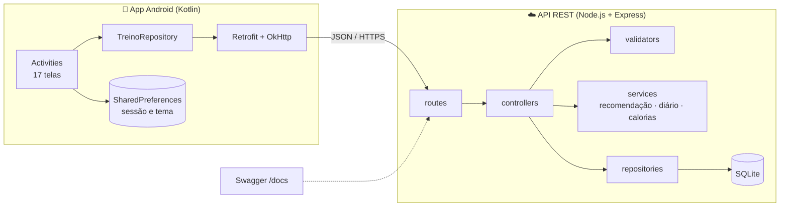
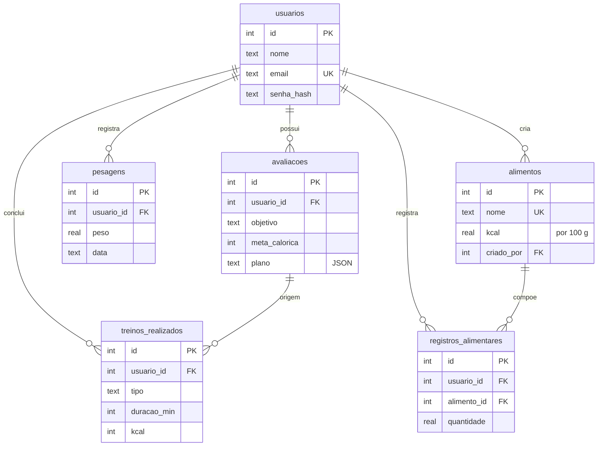

<div align="center">

# 🏋️ TreinoCerto

**Treino personalizado, contagem de calorias e acompanhamento de progresso em um só app.**

Aplicativo Android nativo em Kotlin integrado a uma API REST própria (Node.js + SQLite), documentada com Swagger e publicada na nuvem.

<p>
  
  
  
  
  
  
  
  
</p>

<p>
  
  
  
  
</p>

[**📖 Swagger (API no ar)**](https://treino-certo-api.onrender.com/docs) ·
[**🌐 API**](https://treino-certo-api.onrender.com/api/health) ·
[**👤 Autor**](#-autor)

</div>

---

## 📌 Sobre o projeto

O **TreinoCerto** ajuda o usuário a treinar e se alimentar melhor. A partir de um questionário, o app monta um **plano de treino semanal personalizado**, calcula a **meta diária de calorias e proteínas** e acompanha o dia a dia: **diário alimentar** (no estilo de um contador de calorias), **registro de peso** com gráfico, **treinos realizados** e **progresso semanal**.

O projeto foi desenvolvido para a disciplina de **Desenvolvimento Mobile** do curso de Análise e Desenvolvimento de Sistemas (Ibmec) e evoluiu para um projeto de portfólio, com back-end próprio, testes automatizados e deploy na nuvem.

> 🔑 **Para testar:** login `maria@email.com` · senha `123456`. A API gratuita "dorme" após 15 min sem uso; o primeiro acesso pode levar cerca de 50 segundos.

## ✨ Destaques

- 🧠 **Motor de recomendação próprio:** calcula IMC, taxa metabólica basal (Mifflin-St Jeor), intensidade recomendada e monta o plano semanal, **removendo exercícios contraindicados** para as limitações do usuário (joelho, coluna, ombro, cardíaca).
- 🍽️ **Contador de calorias:** 74 alimentos (base TACO), cálculo em tempo real pela quantidade ingerida, macronutrientes, meta × consumido × restante e **criação de alimentos próprios** a partir da tabela nutricional da embalagem.
- 🏃 **Treinos:** marcação de treino concluído (sem duplicar), cadastro de treinos avulsos com **estimativa de calorias pelo MET**, sequência de dias e meta semanal.
- 📈 **Gráfico de peso** desenhado com `Canvas` (View personalizada), com linha da meta.
- 🔐 **Autenticação:** cadastro, login e troca de senha, com senhas guardadas como **hash scrypt + salt**.
- 🌓 **Tema claro e escuro**, Material Design 3 e layout preparado para o Android 15 (edge-to-edge).
- 📲 **Integração com o celular** por Intents implícitas: agenda, mapas, compartilhamento, navegador e e-mail.
- ☁️ **API publicada no Render**, documentada com **OpenAPI/Swagger** e coberta por **39 testes automatizados**.

## 🧩 Funcionalidades

| Área | O que faz |
|---|---|
| **Conta** | Login, cadastre-se, trocar senha e sair |
| **Avaliação** | Questionário em 7 blocos (objetivo, nível, disponibilidade, local, rotina, medidas e limitações) que gera perfil, IMC, intensidade, meta calórica, plano semanal e dicas |
| **Planos** | Histórico com favoritos, anotações, compartilhamento e "Concluí este treino" em cada dia |
| **Meus treinos** | Cadastro de corrida, natação, musculação etc., resumo dos últimos 7 dias, agenda do celular e academias próximas |
| **Diário alimentar** | Refeições do dia, metas, macros, navegação por datas, busca por nome ou categoria e alimentos personalizados |
| **Peso** | Uma pesagem por dia, variação, quanto falta para a meta e gráfico de evolução |
| **Progresso** | Treinos na semana × meta, dias seguidos, total de treinos e minutos, últimos 7 dias |
| **Perfil** | Dados da conta, edição, troca de senha e atalhos |

## 🏗️ Arquitetura



- **App:** as Activities cuidam só da interface; o `TreinoRepository` concentra o acesso à API e devolve um `Resultado` (`Sucesso` ou `Erro`), com tratamento de falhas de rede e mensagens amigáveis. Uma `TelaBase` comum aplica a barra superior, o botão de tema e o espaçamento das barras do sistema.
- **API:** camadas separadas (rotas → controllers → validações/serviços → repositórios → banco), injeção do banco para facilitar os testes, erros em formato único e documentação OpenAPI servida em `/docs`.

## 🛠️ Tecnologias

| App Android | API REST |
|---|---|
| Kotlin · Activities + XML · ViewBinding | Node.js 22 · Express |
| Retrofit 2 · Gson · OkHttp | SQLite (`node:sqlite`) |
| Coroutines (`lifecycleScope`) | Swagger UI · OpenAPI 3 |
| Material Components 3 · RecyclerView · CardView | `node:crypto` (scrypt) |
| SharedPreferences | `node:test` · Supertest |
| minSdk 24 · targetSdk 35 | Deploy no Render |

## ▶️ Como executar

**Pré-requisitos:** Android Studio e Node.js 22.13+.

### App Android

1. Abra a pasta **`android/`** no Android Studio e aguarde o Gradle sincronizar.
2. Clique em **Run ▶**. Por padrão o app usa a API na nuvem.

Para usar a API rodando no seu computador, altere `API_BASE_URL` em `android/gradle.properties`:

| Cenário | `API_BASE_URL` |
|---|---|
| API na nuvem (padrão) | `https://treino-certo-api.onrender.com/` |
| API local + emulador | `http://10.0.2.2:3000/` |
| API local + celular no mesmo Wi-Fi | `http://IP_DO_COMPUTADOR:3000/` |

### API

```bash
cd backend
npm install
npm run seed   # dados de exemplo (login maria@email.com / 123456)
npm start      # http://localhost:3000/docs
npm test       # 39 testes
```

### Deploy

A API está no [Render](https://render.com) (plano gratuito), configurada pelo arquivo [`render.yaml`](render.yaml): raiz `backend`, build `npm install && npm run seed`, start `npm start`, variáveis `NODE_VERSION=22.13.0` e `TZ=America/Sao_Paulo` e health check em `/api/health`.

## 🌐 API REST

Documentação interativa completa: **[treino-certo-api.onrender.com/docs](https://treino-certo-api.onrender.com/docs)**.

<details>
<summary><b>Ver todos os endpoints</b></summary>

| Método | Endpoint | Descrição |
|---|---|---|
| GET | `/api/health` | Verifica se a API está no ar |
| POST | `/api/auth/login` | Login (e-mail e senha) |
| POST | `/api/usuarios` | Cadastre-se |
| GET · PUT · DELETE | `/api/usuarios/{id}` | Consulta, edição e remoção do usuário |
| PUT | `/api/usuarios/{id}/senha` | Troca a senha (exige a atual) |
| GET | `/api/usuarios/{id}/avaliacoes` | Histórico de avaliações |
| POST | `/api/avaliacoes` | Envia o questionário e gera o plano |
| GET · PATCH · DELETE | `/api/avaliacoes/{id}` | Consulta, anotações/favorito e remoção |
| GET · POST | `/api/alimentos` | Busca alimentos e cria alimento personalizado |
| GET | `/api/usuarios/{id}/diario?data=` | Diário do dia com totais e meta |
| POST | `/api/registros-alimentares` | Adiciona alimento ao diário |
| PUT · DELETE | `/api/registros-alimentares/{id}` | Altera ou remove item do diário |
| GET | `/api/usuarios/{id}/pesagens` | Histórico de peso |
| POST · DELETE | `/api/pesagens` · `/api/pesagens/{id}` | Registra (uma por dia) ou remove pesagem |
| POST | `/api/treinos-realizados` | Registra treino do plano ou avulso, com calorias |
| GET | `/api/usuarios/{id}/treinos-realizados` | Lista treinos feitos |
| DELETE | `/api/treinos-realizados/{id}` | Remove treino |
| GET | `/api/usuarios/{id}/progresso` | Resumo de progresso |

</details>

<details>
<summary><b>Modelo do banco de dados</b></summary>



</details>

<details>
<summary><b>Estrutura de pastas</b></summary>

```
treino-certo/
├── android/                         # App Android (Android Studio)
│   └── app/src/main/java/com/treinocerto/app/
│       ├── data/
│       │   ├── model/               # data classes e enums do domínio
│       │   ├── remote/              # interface Retrofit e cliente HTTP
│       │   ├── repository/          # TreinoRepository + Resultado
│       │   └── local/               # sessão e preferência de tema
│       ├── ui/                      # uma pasta por tela + componentes comuns (TelaBase...)
│       └── util/                    # Intents implícitas, formatação, extensões
├── backend/                         # API REST
│   ├── src/
│   │   ├── routes/ controllers/ services/ repositories/ validators/
│   │   ├── db/                      # schema, migrações e alimentos iniciais
│   │   └── docs/openapi.yaml        # especificação Swagger
│   ├── scripts/dados-exemplo.js     # npm run seed
│   └── test/                        # testes automatizados
└── render.yaml                      # deploy no Render
```

</details>

<details>
<summary><b>Requisitos acadêmicos atendidos (AP2 · Desenvolvimento Mobile)</b></summary>

- **17 Activities** com navegação por **Intents explícitas** (dados passados por `putExtra`).
- **Intents implícitas** (`util/IntentsExternas.kt`): `ACTION_SEND` (compartilhar), `ACTION_VIEW` com `https://` (Swagger, OMS e vídeos dos exercícios) e com `geo:` (academias próximas), `ACTION_INSERT` na agenda (`CalendarContract`) e `ACTION_SENDTO` com `mailto:`.
- **Componentes de interface:** TextView, EditText, Button, ImageView, ImageButton, CheckBox, RadioButton, Spinner, Switch, SeekBar, ProgressBar, RecyclerView, CardView, Chip, FloatingActionButton, BottomSheet, DatePicker, AlertDialog e View personalizada.
- **API REST documentada com Swagger**, operações de cadastro, consulta, alteração e remoção, dados em JSON.
- **Banco relacional (SQLite)** com chaves estrangeiras, persistido pela API.
- **Bônus:** deploy da API em nuvem (Render).

</details>

## 👤 Autor

**Pedro Brito**: estudante de Análise e Desenvolvimento de Sistemas no Ibmec, desenvolvedor mobile (Kotlin, Swift, React Native) e front-end (React).

[](https://www.linkedin.com/in/pedro-brito-12b13a218/)
[](https://github.com/pbritodev)

## 📄 Licença

Distribuído sob a licença MIT. Veja [`LICENSE`](LICENSE).

> ⚠️ As recomendações do app têm caráter educativo e não substituem a orientação de um profissional de Educação Física, nutricionista ou médico.
