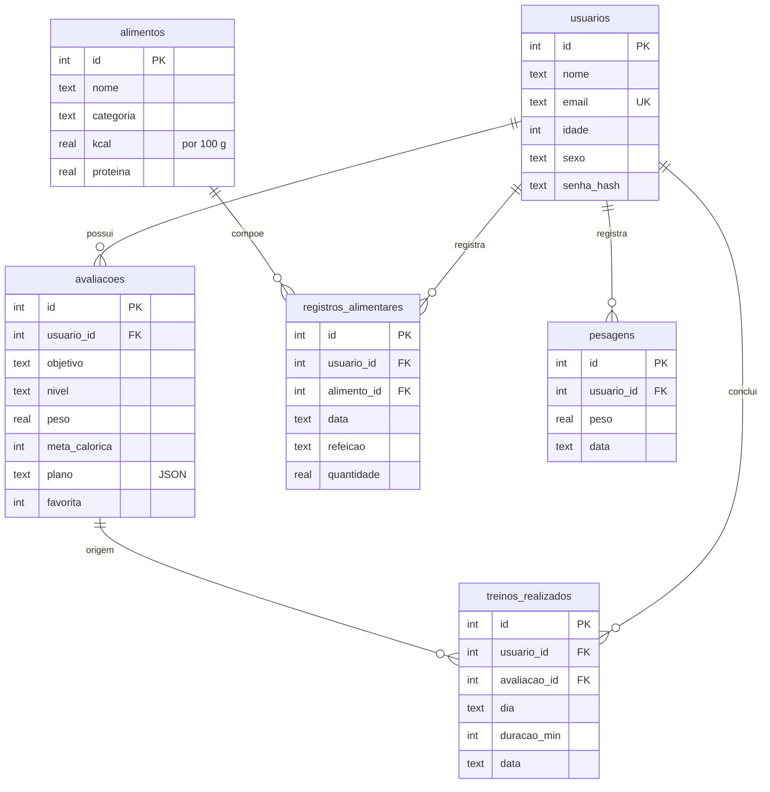

# 🏋️ TreinoCerto

Aplicativo Android que monta um **plano de treino personalizado** a partir de um questionário e acompanha a **alimentação (contagem de calorias)** e o **peso** do usuário. Todos os dados ficam em um banco relacional, acessado por uma **API REST documentada com Swagger**.

> Trabalho da Avaliação Parcial 2 (AP2) de Desenvolvimento Mobile.

---

## 📌 Proposta

1. O usuário **cria uma conta (Cadastre-se)** com nome, e-mail, idade, sexo e senha, e depois **entra com login e senha**.
2. Responde um questionário com 7 blocos: objetivo, nível, disponibilidade, local de treino, rotina (atividade diária e sono), medidas (peso, altura e peso desejado) e limitações físicas.
3. A API processa as respostas e devolve um **resultado personalizado**:
   - perfil (ex.: *Queimador de Calorias · Intermediário*);
   - intensidade recomendada (0 a 100) e classificação (Leve, Moderada ou Intensa);
   - IMC e classificação;
   - **meta diária de calorias e proteínas** (TMB de Mifflin-St Jeor × fator de atividade, ajustada ao objetivo);
   - plano semanal com exercícios, séries e repetições, **sem os exercícios contraindicados** para as limitações informadas;
   - dicas personalizadas (sono, tempo estimado até o peso desejado, cuidados cardíacos etc.).
4. No **diário alimentar** (no estilo MyFitnessPal), o usuário registra o que comeu em cada refeição. As calorias e os macronutrientes são calculados pela quantidade ingerida e comparados à meta do dia.
5. Em **Meu peso**, registra as pesagens e acompanha a evolução em um gráfico.
6. Em cada dia do plano, toca em **"Concluí este treino"**. A tela **Meu progresso** mostra o perfil, os treinos feitos, a meta da semana, a sequência de dias e os últimos 7 dias.

## ✨ Funcionalidades

| Área | O que faz |
|---|---|
| Conta | **Login**, **Cadastre-se**, **trocar senha** (senha guardada com hash scrypt + salt) e sair |
| Meu perfil | Avatar com iniciais, dados da conta, edição (PUT), atalhos para progresso e troca de senha |
| Meu progresso | Perfil e plano atual, treinos na semana × meta, dias seguidos, total de treinos e minutos, últimos 7 dias, peso e lista de treinos realizados |
| Avaliação | Questionário completo, geração do plano e da meta calórica |
| Histórico | Lista de planos, filtro de favoritos, anotações e favorito (PATCH), exclusão (DELETE) com deslize |
| Diário alimentar | Meta × consumido × restante, macros, navegação por dias, busca de alimentos por nome e categoria, cálculo em tempo real pela quantidade, edição e exclusão de itens |
| Peso | Registro com data e observação, gráfico de evolução com linha da meta, variação entre pesagens |
| Aparência | Tema **claro e escuro**: botão na Home e opção Sistema/Claro/Escuro em Sobre |
| Compartilhar | Envio do plano por WhatsApp, e-mail etc. |

---

## ✅ Requisitos da AP2 atendidos

### 14 Activities

| # | Activity | Função |
|---|---|---|
| 1 | `LoginActivity` | Login (tela de entrada) |
| 2 | `CadastroActivity` | Cadastre-se e edição dos dados |
| 3 | `TrocarSenhaActivity` | Troca de senha |
| 4 | `PerfilActivity` | Meu perfil |
| 5 | `ProgressoActivity` | Meu progresso (treinos realizados) |
| 6 | `MainActivity` | Home: saudação, resumo do dia, menu em grade e botão de tema |
| 7 | `QuestionarioActivity` | Formulário da avaliação |
| 8 | `ResultadoActivity` | Plano gerado |
| 9 | `HistoricoActivity` | Lista de planos salvos |
| 10 | `DetalheActivity` | Detalhes, anotações, favorito e exclusão de um plano |
| 11 | `DiarioActivity` | Diário alimentar do dia |
| 12 | `AdicionarAlimentoActivity` | Busca de alimentos e quantidade consumida |
| 13 | `PesoActivity` | Pesagens e gráfico de evolução |
| 14 | `SobreActivity` | Informações, tema e links |

### Intents

- **Explícitas**: navegação entre todas as telas, passando dados por `putExtra` (ex.: `Extras.AVALIACAO_ID` do questionário para o resultado e do histórico para o detalhe; data e refeição do diário para a busca de alimentos).
- **Implícitas** (centralizadas em `util/IntentsExternas.kt`):
  - `ACTION_SEND`: compartilhar o plano e indicar o app;
  - `ACTION_VIEW` com `https://`: abrir o Swagger, a página da OMS e um vídeo de execução de cada exercício (toque no exercício);
  - `ACTION_VIEW` com `geo:`: academias ou parques próximos no app de mapas;
  - `ACTION_SENDTO` com `mailto:`: e-mail de contato.

### Componentes de interface (Views)

`TextView`, `EditText` (`TextInputEditText`), `Button`, `ImageView`, `ImageButton`, `CheckBox`, `RadioButton`/`RadioGroup`, `Spinner`, `Switch` (`MaterialSwitch`), `SeekBar`, `ProgressBar` (circular e horizontal), `RecyclerView`, `CardView`, `Chip`/`ChipGroup`, `ExtendedFloatingActionButton`, `BottomSheetDialog`, `DatePickerDialog`, `AlertDialog` e uma **View personalizada** desenhada com `Canvas` (`GraficoPesoView`).

### UX/UI

- Material Design 3 com paleta verde e laranja consistente e **modo escuro** com cores próprias.
- Feedback em todas as ações: `ProgressBar` durante as chamadas à API, `Snackbar` com **"Tentar novamente"** em caso de erro, `Toast` de confirmação, diálogo antes de excluir e estados vazios com ação.
- Validação de formulários com mensagens no próprio campo.
- Cálculo de calorias **em tempo real** enquanto o usuário digita a quantidade.

---

## 🛠️ Tecnologias

**Aplicativo Android**
- Kotlin, Activities + layouts XML, ViewBinding
- Retrofit 2 + Gson + OkHttp (logging)
- Kotlin Coroutines (`lifecycleScope`)
- Material Components 3, RecyclerView, CardView
- SharedPreferences (sessão do usuário e tema)
- minSdk 24 · targetSdk 35

**API REST**
- Node.js 22+ e Express
- SQLite pelo módulo nativo `node:sqlite` (sem dependências nativas para compilar)
- Swagger UI (`swagger-ui-express`) com especificação OpenAPI 3
- Senhas com hash `scrypt` + salt (módulo nativo `node:crypto`)
- Testes automatizados com `node:test` + `supertest` (30 testes)

---

## 📁 Estrutura do projeto

```
treino-certo/
├── backend/                     # API REST (Node.js + Express + SQLite)
│   ├── src/
│   │   ├── app.js               # monta o Express (rotas, Swagger, erros)
│   │   ├── server.js            # ponto de entrada
│   │   ├── config/              # porta e caminho do banco
│   │   ├── db/                  # schema das tabelas e carga inicial de alimentos
│   │   ├── routes/              # definição dos endpoints
│   │   ├── controllers/         # recebem a requisição e devolvem a resposta
│   │   ├── services/            # regras de negócio (recomendação, diário)
│   │   ├── repositories/        # SQL e conversão banco ⇄ JSON
│   │   ├── validators/          # validação dos dados de entrada
│   │   ├── middlewares/         # tratamento de erros
│   │   └── docs/openapi.yaml    # documentação Swagger
│   ├── scripts/dados-exemplo.js # dados de demonstração (npm run seed)
│   └── test/                    # testes automatizados
├── android/                     # Projeto Android Studio
│   └── app/src/main/java/com/treinocerto/app/
│       ├── data/
│       │   ├── model/           # data classes e enums do domínio
│       │   ├── remote/          # interface Retrofit e cliente HTTP
│       │   ├── repository/      # TreinoRepository + Resultado (sucesso/erro)
│       │   └── local/           # SharedPreferences (sessão e tema)
│       ├── ui/                  # uma pasta por tela + componentes comuns
│       └── util/                # Intents implícitas, formatação, extensões
├── docs/screenshots/            # capturas de tela
└── render.yaml                  # deploy da API no Render
```

O app segue uma separação em camadas: as **Activities** cuidam só da interface e chamam o **TreinoRepository**, que usa o **Retrofit** e devolve um `Resultado` (`Sucesso` ou `Erro` com mensagem amigável). Na API, **routes → controllers → services/validators → repositories → SQLite**.

---

## ▶️ Como executar

### 1. API (backend)

Pré-requisito: **Node.js 22.13 ou superior** (`node --version`).

```bash
cd backend
npm install
npm run seed     # (opcional) dados de exemplo — login: maria@email.com / senha: 123456
npm start
```

- API: `http://localhost:3000/api`
- **Swagger: http://localhost:3000/docs**
- Testes: `npm test`

O banco `treino_certo.db` é criado automaticamente na pasta `backend/`. O caminho e a porta podem ser alterados pelas variáveis `DB_PATH` e `PORT`.

### 2. Aplicativo Android

1. Abra a pasta **`android/`** no Android Studio e aguarde o Gradle sincronizar.
2. Configure o endereço da API em `android/gradle.properties`:
   | Onde o app roda | `API_BASE_URL` |
   |---|---|
   | Emulador do Android Studio | `http://10.0.2.2:3000/` (padrão) |
   | Celular físico na mesma rede Wi-Fi | `http://IP_DO_COMPUTADOR:3000/` (ex.: `http://192.168.0.15:3000/`) |
   | API publicada na nuvem | `https://seu-servico.onrender.com/` |
3. Clique em **Run ▶**.

> No celular físico, descubra o IP do computador com `ipconfig` (Windows) ou `ip a` (Linux/macOS) e libere a porta 3000 no firewall.

### 3. (Bônus) Deploy da API na nuvem

O arquivo `render.yaml` permite publicar a API no [Render](https://render.com) (plano gratuito):

1. Crie uma conta no Render e escolha **New → Blueprint**.
2. Selecione este repositório e confirme.
3. Ao final, o Swagger fica em `https://<nome-do-servico>.onrender.com/docs`. Coloque essa URL em `API_BASE_URL`.

> No plano gratuito o disco é temporário: o banco é recriado com os dados de exemplo a cada novo deploy, e o primeiro acesso após um período parado pode levar cerca de 1 minuto.

---

## 🌐 API REST

Todos os dados trafegam em **JSON**. A documentação interativa completa (com exemplos e o botão *Try it out*) está no **Swagger em `/docs`**.

| Método | Endpoint | Descrição |
|---|---|---|
| GET | `/api/health` | Verifica se a API está no ar |
| POST | `/api/auth/login` | Login (e-mail e senha) |
| PUT | `/api/usuarios/{id}/senha` | Troca a senha (exige a atual) |
| GET | `/api/usuarios` | Lista usuários |
| POST | `/api/usuarios` | Cadastre-se (com senha) |
| GET | `/api/usuarios/{id}` | Busca usuário |
| PUT | `/api/usuarios/{id}` | Atualiza usuário |
| DELETE | `/api/usuarios/{id}` | Remove usuário e seus dados (cascade) |
| GET | `/api/usuarios/{id}/avaliacoes` | Histórico de avaliações |
| POST | `/api/avaliacoes` | Envia o questionário e gera o plano |
| GET | `/api/avaliacoes/{id}` | Busca avaliação |
| PATCH | `/api/avaliacoes/{id}` | Atualiza observação e favorito |
| DELETE | `/api/avaliacoes/{id}` | Remove avaliação |
| GET | `/api/alimentos?busca=&categoria=` | Lista ou busca alimentos |
| GET | `/api/alimentos/{id}` | Busca alimento |
| GET | `/api/usuarios/{id}/diario?data=AAAA-MM-DD` | Diário do dia com totais e meta |
| POST | `/api/registros-alimentares` | Adiciona alimento consumido |
| PUT | `/api/registros-alimentares/{id}` | Altera quantidade ou refeição |
| DELETE | `/api/registros-alimentares/{id}` | Remove item do diário |
| GET | `/api/usuarios/{id}/pesagens` | Histórico de peso |
| POST | `/api/pesagens` | Registra pesagem |
| DELETE | `/api/pesagens/{id}` | Remove pesagem |
| POST | `/api/treinos-realizados` | Registra treino concluído |
| GET | `/api/usuarios/{id}/treinos-realizados` | Lista treinos concluídos |
| DELETE | `/api/treinos-realizados/{id}` | Remove treino registrado |
| GET | `/api/usuarios/{id}/progresso` | Resumo de progresso (perfil, semana, sequência, últimos 7 dias) |

Exemplo, criando uma avaliação:

```http
POST /api/avaliacoes
Content-Type: application/json

{
  "usuarioId": 1, "objetivo": "HIPERTROFIA", "nivel": "INICIANTE",
  "diasSemana": 4, "minutosSessao": 60, "local": "ACADEMIA",
  "restricoes": ["JOELHO"], "peso": 70.5, "altura": 1.72,
  "pesoMeta": 74, "atividadeDiaria": "LEVE", "horasSono": 7
}
```

Os erros seguem um formato único, por exemplo `400 { "erro": "Dados inválidos", "detalhes": ["peso deve estar entre 30 e 300 kg"] }`, e as mensagens aparecem no app.

### Banco de dados (SQLite)



A tabela `alimentos` é preenchida automaticamente com 44 alimentos comuns. Os valores são aproximados, com base na Tabela Brasileira de Composição de Alimentos (TACO). As calorias de cada registro são calculadas por `kcal_por_100g × quantidade ÷ 100`.

---

## 📱 Capturas de tela

| Home | Home (escuro) | Questionário | Resultado | Histórico |
|---|---|---|---|---|
|  |  |  |  |  |

| Detalhe | Diário alimentar | Adicionar alimento | Meu peso | Sobre |
|---|---|---|---|---|
|  |  |  |  |  |

| Login | Cadastre-se | Meu perfil | Meu progresso | Trocar senha |
|---|---|---|---|---|
|  |  |  |  |  |

---

## ⚠️ Aviso

As recomendações têm caráter educativo e não substituem a orientação de um profissional de Educação Física, de um nutricionista ou de um médico.
